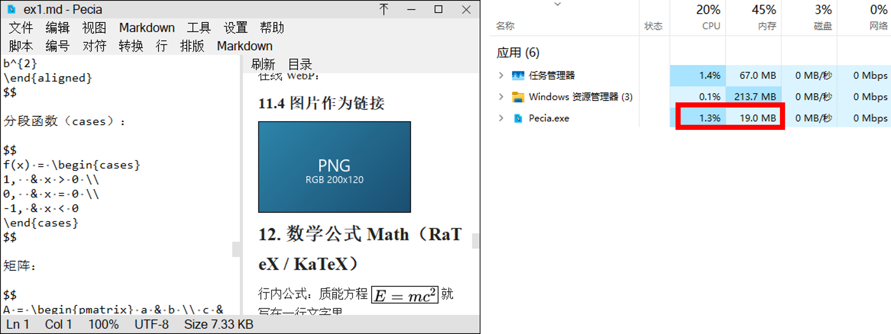
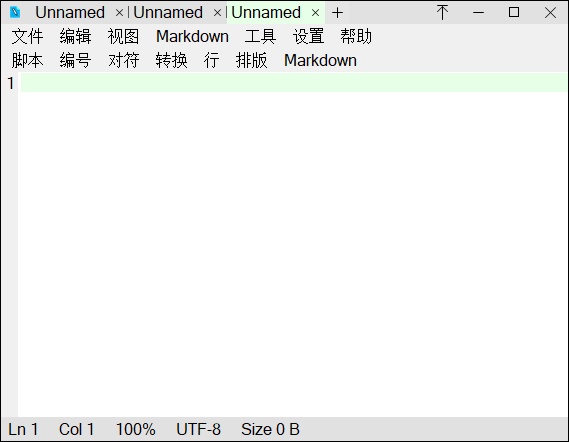
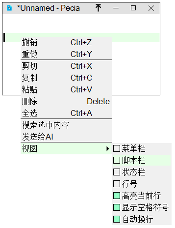
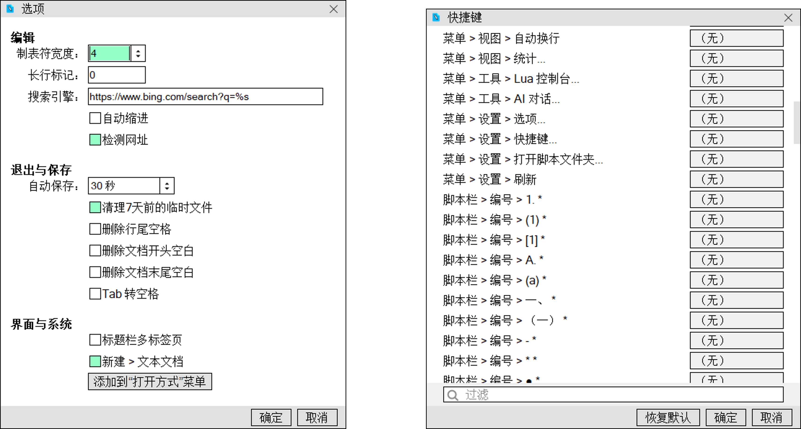
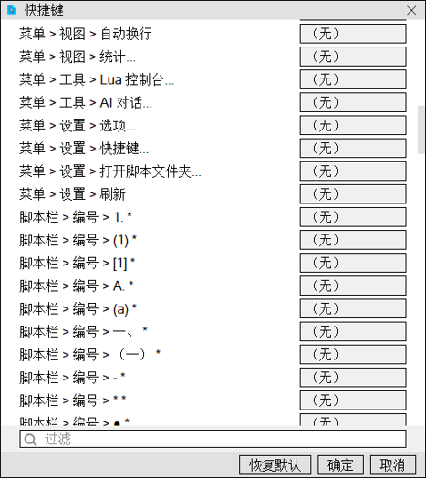
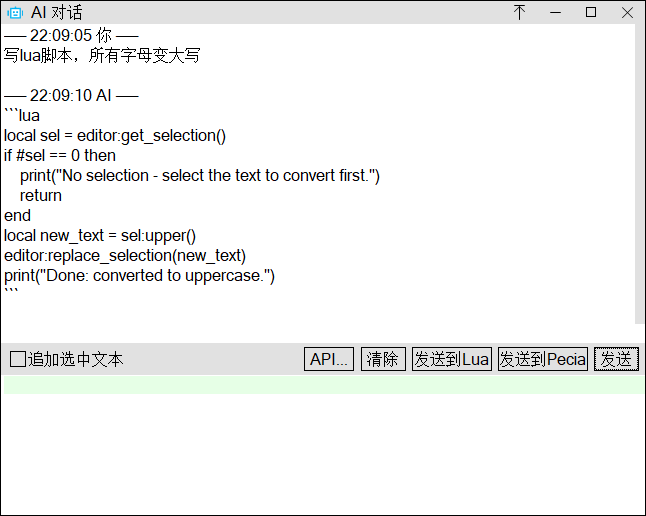
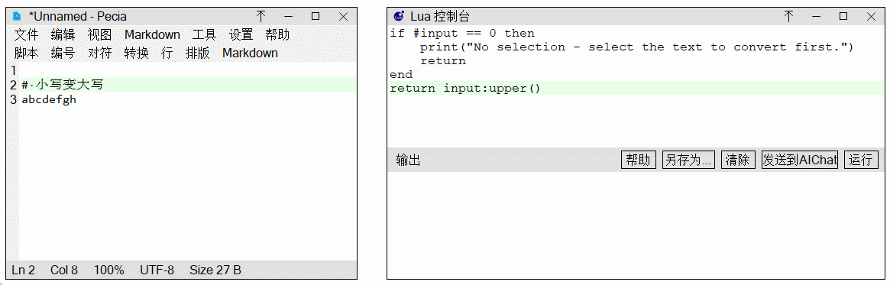
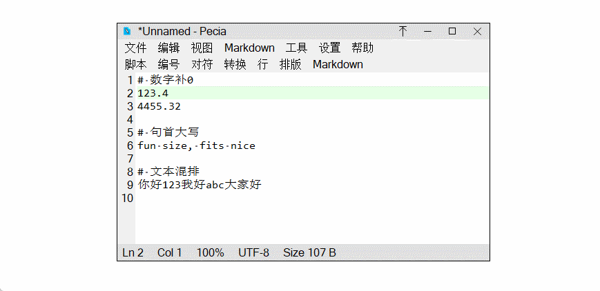

> **🌐 Languages**: [中文](../../README.md) | [English](README.en.md) | [日本語](README.ja.md) | [한국어](README.ko.md) | [Deutsch](README.de.md) | [Français](README.fr.md) | [Español](README.es.md) | [Русский](README.ru.md) | [Português-BR](README.pt-BR.md) | [Italiano](README.it.md) | [繁體中文](README.zh-TW.md) | [العربية](README.ar.md) | [हिन्दी](README.hi.md) | [Indonesia](README.id.md) | [Türkçe](README.tr.md) | [Tiếng Việt](README.vi.md)

---

# Pecia — Minimalist Text Editor

**[⬇️ Download Latest (1.1.2) (Gitee)](https://gitee.com/qiuzongman/pecia/releases/download/1.1.2/Pecia_x64_1.1.2.zip)** ｜ **[⬇️ Download Latest (1.1.2) (GitHub)](https://github.com/zongmanqiu/Pecia/releases/download/1.1.2/Pecia_x64_1.1.2.zip)** ｜ [Gitee Repo](https://gitee.com/qiuzongman/pecia) ｜ [GitHub Mirror](https://github.com/zongmanqiu/Pecia) | [Bilibili Demo](https://www.bilibili.com/video/BV144Yo6oEz9/)

A lightweight text editor for Windows built with C++17 + FLTK. Multi-tab, instant opening of large files, multiple encoding support, Lua scripting extensions. New: side panel (file tree / outline), font picker dialog, window shadows; chunked Markdown preview for very large documents.

> **Platform scope**: Supports **Windows x64 (64-bit) only**. No 32-bit version is provided, and cross-platform support (Linux/macOS/32-bit) is no longer maintained. The build scripts include a built-in 64-bit check (see the top of CMakeLists); attempting to build for 32-bit will produce an error.

## Software Interface

- Markdown preview
  - 
- Multi-tab
  - 
- Minimal status bar
  - 
- Options
  - 
- Shortcut settings
  - 
- AI chat
  - 
- Lua console
  - 
- Lua scripts
  - 


## Quick Start

### Prerequisites (basic environment, excluding source code and third-party libraries)

- Windows 10/11 x64 (1803+ or later, with built-in curl/tar download tools)
- **Visual Studio Build Tools 2022 / VS2022** (with C++ Desktop workload)
  - The script includes `build/msvc_env.bat` which **auto-detects** MSVC and Windows SDK (does not depend on vcvars/vswhere/Developer Command Prompt — a regular cmd double-click works). You can also use the environment variables `PECIA_MSVC_ROOT` / `PECIA_SDK_ROOT` to specify custom install locations
- **CMake ≥ 3.16** (must be in PATH; generator uses **NMake Makefiles**, no Ninja needed)
- **Rust toolchain** (≥ 1.85, supporting edition 2024; used to compile the mmdr and RaTeX FFI rendering libraries, installed via https://rustup.rs; first build requires an internet connection to fetch dependencies from crates.io)
- **Internet connection** (only needed for first build: 2_download.bat downloads dependencies + `cargo fetch` in 4_build_rust.bat pulls crates)
- **git is not required** (dependencies are downloaded with curl + extracted with tar)

### Build (recommended: one-click)

```bat
REM After downloading the source, just double-click this single script.
REM It runs everything in sequence: 1 check toolchain → 2 download 6 third-party libraries → 3 apply patches →
REM 4 cargo fetch + compile two Rust FFI libraries → 5 compile FLTK + CMake builds Pecia trio →
REM run 27 unit tests.
REM First build time depends on network and machine; subsequent builds reuse the cache, incremental compile + test takes about 1-2 minutes.
build\full.bat
```

> Step-by-step build scripts, tests and packaging: see `build/build_readme.md`. Release process: see `docs/RELEASE_CHECKLIST.md`. Architecture design (process model/layering/subsystems): see the 'Architecture Overview' at the beginning of `开发指南.md`.

## Directory Structure

```
main/
├── CMakeLists.txt      Build rules (CMake entry point)
├── main.cpp            Program entry point
├── README.md           This document (project intro/download/interface/build entry)
├── docs/               README in other languages (README.<lang>.md) + interface screenshots + intro.pptx
├── 目录结构说明.md      Directory and module conventions (essential reading for onboarding)
├── 开发指南.md         Development/release workflow, architecture overview and pre-commit checklist
├── AGENTS.md           Engineering conventions (contributors/AI rules)
├── HISTORY.md          Version history (append a new version section at the top on release; keep old content unchanged)
├── LICENSE             Verbatim official AGPL-3.0 text (UTF-8, no BOM; terms must not be modified)
├── THIRD-PARTY-NOTICES.md  Third-party library notices (name/version/license/patch count)
├── .gitignore          Version-control ignore rules
├── .gitattributes      Line-ending and text attribute rules
├── core/               Core pure logic (no UI)
├── editor/             Editor widget
├── ui/                 Windows/dialogs/toolbars
├── LuaTool/            PeciaLua standalone tool (window/entry/pipeline server)
├── AIChat/             PeciaAIChat standalone tool (window/entry)
├── script/             Lua script engine
├── DOCS_MANIFEST.md    Documentation manifest (check each item after code changes, test_docs gate; dev-only, not shipped with exe)
├── image/              Image resources (pecia.ico / ai_bot.ico / lua.ico …)
├── test/               Unit test source code
├── lang/               Language files (16 × .ini)
├── theme/              Theme color files (light.ini/dark.ini/cream.ini/mint.ini/ice.ini)
├── example/            Documentation examples (showcasing Markdown rendering: Mermaid diagrams, LaTeX formulas, images, etc.)
├── patches/            Archive of modifications to .thirdparty library source code (automatically applied during build)
├── mdview/             Markdown preview (preview panel/HTML rendering, including mmdr FFI headers)
└── build/              Build scripts and build helper source code
```

## Tech Stack

| Component | Version | Repository |
|---|---|---|
| C++ | C++17 | — |
| FLTK | 1.4.5 | https://github.com/fltk/fltk |
| Lua | 5.5.1 | https://github.com/lua/lua |
| PCRE2 | 10.47 | https://github.com/PCRE2Project/pcre2 |
| md4c | 2026-09-11 (10fa4f44) | https://github.com/mity/md4c |
| litehtml | 0.10 | https://github.com/litehtml/litehtml |
| stb | 2026-08-02 (2c980bb5) | https://github.com/nothings/stb |
| mmdr (mermaid-rs-renderer) | 0.3.1 | crates.io (cargo) |
| RaTeX (formula rendering, built-in) | 0.1.14 | crates.io (cargo) |
| Rust | ≥ 1.85 | https://rustup.rs |
| Build | CMake + NMake Makefiles + MSVC | — |

> Tip: You can make local modifications to third-party library source code; the complete modified files must be archived in
> `main/patches/<library_name>/` (automatically overwritten during build by 3_patch.bat), not just textual diffs.
> When upgrading, pull the new version from the above repositories and replay the patches (see build/FLTK_PATCHES.md for an example).
> mmdr bundles resvg 0.47 (the project's only SVG rasterizer: both mermaid diagrams and LaTeX formula SVGs are rasterized to PNG by it); RaTeX only generates SVG strings and does not directly depend on resvg.

---

## License

[GNU AGPL-3.0](../../LICENSE).

Licenses, modification (patch) notes, and distribution obligations for third-party components (FLTK/Lua/PCRE2/md4c/litehtml/stb and Rust crates) are listed in [THIRD-PARTY-NOTICES.md](../../THIRD-PARTY-NOTICES.md).
